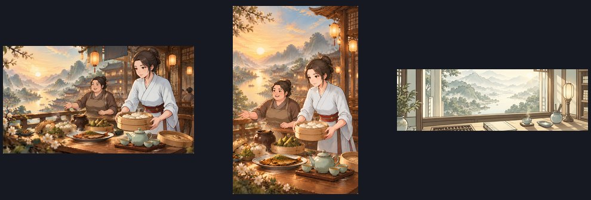

# 素材参考：看什么，带走什么

## 公开成品｜《掌柜请留步》

[TapTap 公开页](https://www.taptap.cn/app/949661)。首发横、方与玩法展示图的公开页面资源已与本地成品、上传记录比对；Windows 参考来自后续上线批次。这里只使用公开成品链接和上线物料缩略图，不提供原始项目素材、未发布候选、生成任务或后台记录。以下是通过成品和返工记录得到的设计判断，不是模型对照实验、转化率或审核适用性的结论。

### 同一视觉，横方两种关系

| 横版宣传图 | 方版宣传图 |
|---|---|
|  |  |
| [打开原图](https://img-tc.tapimg.com/market/images/5e00f6b9ff7560b67496fe388f4fa7d6.jpg) | [打开原图](https://img-tc.tapimg.com/market/images/8e159c82245c22dc27873c49b6aeca49.jpg) |

最早的拼贴问题不是道具不够多，而是它们没有共同的空间和事件。最后用端出一笼点心串起人物、桌面和客栈；远景提供品牌区。横版左侧排字，方版把字和景深往上调整，手、蒸笼与餐桌的关系仍成立。**可迁移的是动作与构图层级，不是青绿山水、夕阳或一定要画人物。** 如果裁完会把端东西的手或标题切掉，就回到母版重构，而不是继续缩小整幅图。

### 同一品牌，不同槽位不必长一样

| 无字横幅 | 无字竖图 | 游戏库背景 |
|---|---|---|
| 见上方左图 | [打开公开成品](https://img-tc.tapimg.com/market/images/e9bc07d6bb38cae04ebb8ac856a8e3b7.jpg) | [打开公开成品](https://img-tc.tapimg.com/market/images/9ba930e04fe9ed7bd09c5f74757c2dc0.jpg) |
| 已有无字画面足够，直接技术导出。 | 用无字横图约束身份、画法和动作，重排上下空间；不是把有字版硬擦一次。 | 最终采用已有无字窗景做技术适配；没有因为出了生成候选就必须用它。 |

**可迁移的是先定不变项，再按槽位取舍。** 两张主视觉保留人物和动作；库背景的职责是承接平台界面，所以可以保留同一美术世界而不复用同一人物场面。安全区按实际目标检查，不继承案例的适配数值。

### 玩法展示不等于未编辑的截图

[打开原图](https://img-tc.tapimg.com/market/images/f386277aaf8b372589831834d6af2243.jpg)。这是**包装过的玩法展示图**，不是未经编辑的实机底稿，也不是通用槽位规范。观察真实棋盘如何承担卖点、插画如何让位；别照搬标题、边框或合成提示。换项目要重新核对平台对真实画面、文字和包装的要求；需要纯截图就直接交真实原图。

## 换题材检查（桌面演练，不是生成案例）

| 给定任务 | 应该继承的方法 | 不要继承的样式或做法 |
|---|---|---|
| 单色像素解谜只做小 Icon，有清晰的原始符号，但当前插图缩小就认不出 | 原游戏符号和像素轮廓当身份，先在列表大小对照；轮廓已可辨就复用，必要时仅改对比和层级 | 不画人物、远景或故事场景，不把像素材质“升级”成平滑渲染；不补横方封面 |
| 3D 科幻竞速横图换竖图：玩家车改成通用跑车，过弯也被裁掉 | 车型轮廓和涂装由项目截图锁定，保留车与弯道的空间关系；换竖幅时重排车、弯道、标题，而非套暖色调 | 竞品图即使适合借动线，也不带走它的车、品牌、光效当成默认；没有授权原车参考就先列缺口 |
| 恐怖项目的预览图被 AI 改了 HUD 数字；目标字段只收真实截图 | 原始截图保留为唯一实机底稿；丢弃 AI 改写结果，按字段交纯截图 | 不用更漂亮的 HUD 或额外包装冒充“素材增强” |

跨项目最小检查：把案例里的题材、色调和角色全部换掉，如果“该保留什么、改什么、看哪里判错”也跟着失效，说明写进规则的是样式而不是方法。
